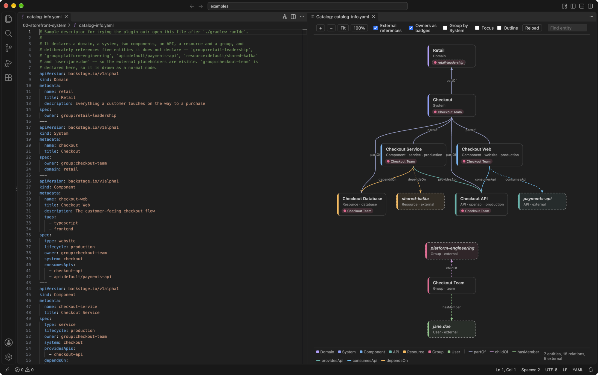
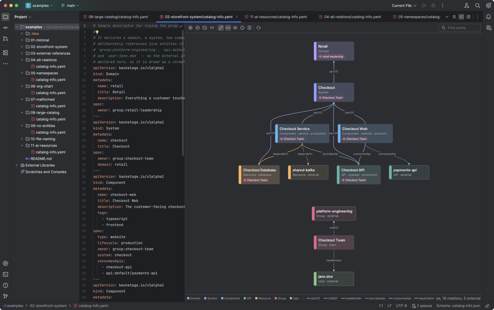
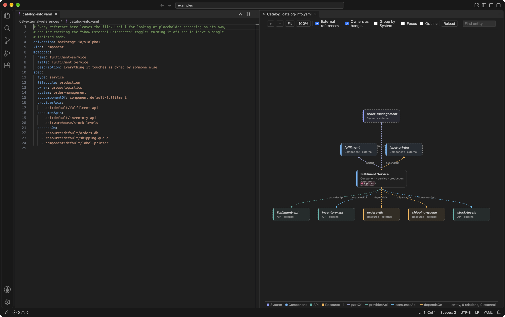
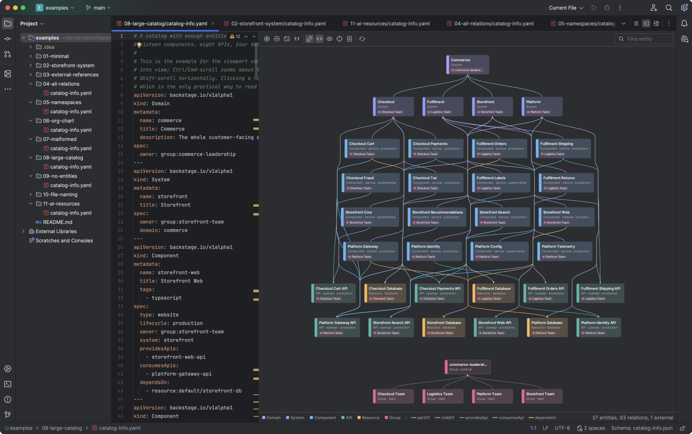

# Backstage Catalog Graph

Editor plugins that draw a Backstage `catalog-info.yaml` as the catalog graph it describes —
entities as nodes, `spec` references as labelled edges, and **dashed placeholders for every
reference that leaves the file**.

The placeholders are the point. A descriptor almost never declares everything it names: the
owning group lives in the org catalog, the system is defined in another repository, a
`dependsOn` points at a resource someone else runs. Dropping those references would draw a
tidier but dishonest picture, so they are drawn as ghosts, and the graph shows both what the
file defines and what it assumes exists.



| Editor | Package | Source |
|---|---|---|
| **VS Code** — and Cursor, Windsurf, VSCodium, Theia, Codespaces | `.vsix` | [`editors/vscode`](editors/vscode) |
| **JetBrains** — IDEA, PyCharm, GoLand, RustRover, … 2025.2 or newer | `.zip` | [`editors/jetbrains`](editors/jetbrains) |

Both are installed from [GitHub Releases](https://github.com/grahambrooks/backstage-catalog-graph/releases);
neither is on a marketplace yet, and no other editors are planned — see [ROADMAP.md](ROADMAP.md).

## Installing

Download the package for your editor from the
[latest release](https://github.com/grahambrooks/backstage-catalog-graph/releases/latest).

- **VS Code**: `code --install-extension backstage-catalog-graph-<version>.vsix`, or
  **Extensions → ⋯ → Install from VSIX…**. Cursor, Windsurf and VSCodium take the same file —
  substitute `cursor`, `windsurf` or `codium` for `code`.
- **JetBrains**: **Settings → Plugins → ⚙ → Install Plugin from Disk…**, and choose the `.zip`
  itself — do not unpack it.

Then open any `catalog-info.yaml`. In VS Code, click **Show Catalog Graph to the Side** in the
editor title bar; in a JetBrains IDE the file opens with a **Text** / **Backstage Catalog** split.

Packages installed this way do not update themselves: install a newer release over the old one.

Each release carries a `SHA256SUMS` file and a signed build-provenance attestation, so a download
can be checked against the workflow run that built it:

```bash
sha256sum --check --ignore-missing SHA256SUMS
gh attestation verify backstage-catalog-graph-<version>.vsix --repo grahambrooks/backstage-catalog-graph
```

## Screenshots

The same descriptors in the JetBrains plugin. Both editors lay a file out identically — the layer
ordering is part of the shared contract — and differ only in how they draw it.



A file whose every reference leaves it: one declared component, and nine placeholders for what
it assumes exists elsewhere.



The 37-entity example, fitted to the pane.



## Layout

```
conformance/          the behaviour contract, and the corpus that pins it
  spec.md             normative: how a descriptor is read and laid out
  manifest.json       every case, and the descriptor it reads
  cases/              edge cases that make poor demos
  expected/           one golden document per case

editors/
  jetbrains/          Kotlin core + Swing canvas, split editor
  vscode/             TypeScript core + SVG webview, preview to the side

examples/             eleven scenarios, doubling as the manual test plan
Makefile              build, package and launch either editor locally (`make` lists targets)
ROADMAP.md            what is deferred, what is not planned, and why
```

## One contract, an implementation per editor

Each editor implements the core — reference resolution, relations, external placeholders,
layered layout — in its own language. Nothing is shared at runtime. What is shared is
[`conformance/`](conformance/spec.md): a corpus of descriptors with a golden document for each,
which **every implementation runs in its own CI, in its own language**.

That is a deliberate trade. The core is about 500 lines and implements a published, slow-moving
format. Sharing it as a compiled artifact would mean a JVM toolchain inside the VS Code build,
or rewriting it for WebAssembly — while the half of the work that actually differs, the
rendering, cannot be shared at any price. Two implementations of 500 lines is the cheaper
problem, *provided* drift is caught mechanically. That is what the corpus is for: a disagreement
about what a descriptor means shows up as a failing test, not as a bug report six months later.

The JetBrains side is the reference implementation and generates the goldens. Changing behaviour
means changing it, regenerating, reading the diff, and then making every other implementation
pass again:

```bash
cd editors/jetbrains && ./gradlew test -Dconformance.update=true
cd editors/vscode    && npm test
```

## Building

`make package` builds both editors' packages into `dist/`; `make` lists every target. Neither
editor needs the other's toolchain, and the commands underneath are:

```bash
# VS Code — needs Node
cd editors/vscode
npm install && npm test && npm run package     # -> backstage-catalog-graph-<version>.vsix

# JetBrains — needs a JDK (Gradle will provision one)
cd editors/jetbrains
./gradlew build                                 # compile, unit tests, conformance corpus
./gradlew runIde                                # sandbox IDE with examples/ open
./gradlew buildPlugin                           # -> backstage-catalog-graph-<version>.zip
./gradlew packageTestKit                        # plugin + examples + TESTING.md
```

## Trying it

[`examples/`](examples/README.md) is a manual test plan of eleven scenarios — the everyday
single-component case, a complete system, placeholder rendering on its own, every relation type,
namespace equality, a Group/User-only graph, each problem the reader reports, a 37-entity
catalog for the viewport controls, the empty state, filename matching, and the alpha
`AiResource` kind. Each lists the exact
entity, placeholder, relation and problem counts it should produce, and those counts are
asserted by both implementations.

- **JetBrains**: `make run-jetbrains`, which opens the large example in a sandbox IDE.
- **VS Code**: `make run-vscode` runs the extension from source (as does <kbd>F5</kbd> in this
  repository); `make run-vscode-package` installs the real `.vsix` into a throwaway profile.

Both take `FILE=examples/<name>/catalog-info.yaml` to open a different example.

## Relations understood

| `spec` field | Relation | Reference defaults to |
|---|---|---|
| `owner` | `ownedBy` | `Group` |
| `system` | `partOf` | `System` |
| `domain` | `partOf` | `Domain` |
| `subcomponentOf` | `partOf` | `Component` |
| `subdomainOf` | `partOf` | `Domain` |
| `parent` | `childOf` | `Group` |
| `children` | `parentOf` | `Group` |
| `members` | `hasMember` | `User` |
| `memberOf` | `memberOf` | `Group` |
| `providesApis` | `providesApi` | `API` |
| `consumesApis` | `consumesApi` | `API` |
| `dependsOn` | `dependsOn` | must name its kind — except on an `AiResource`, where `AiResource` |
| `dependencyOf` | `dependencyOf` | must name its kind |
| `skills`, `plugins` (on an `AiResource`) | `hasPart` | `AiResource` |

`AiResource` is Backstage's alpha kind for AI-tool skills, rules, plugins and marketplaces. A
bare name in `dependsOn` or `dependencyOf` on any other kind is reported as a problem, because
Backstage gives those fields no default kind.

An explicit prefix always wins: `owner: user:grahambrooks` yields a `User`, not a `Group`.
References resolve the way Backstage resolves them — `[<kind>:][<namespace>/]<name>`, with the
entity's own namespace as the default — and compare case-insensitively.
[`conformance/spec.md`](conformance/spec.md) is the full, normative version.

## Deliberately not in scope

Stated so a later change doesn't "complete" something that was cut on purpose:

- **No catalog-wide graph.** The view is scoped to one file. Resolving references against other
  files in the project, or against a running Backstage instance, would remove exactly the
  boundary the external placeholders are there to show.
- **No network access.** Nothing is fetched from a Backstage API, and no `backstage.io/*`
  annotation is dereferenced.
- **No `Location` target expansion.** `spec.targets` holds paths and URLs, not entity
  references, so it produces no edges.
- **No editing.** The graph is a view of the YAML; the YAML is edited as YAML.

## Releasing

CalVer, kept in step across editors: `pluginVersion` in `editors/jetbrains/gradle.properties`
and `version` in `editors/vscode/package.json`. Tag `v<version>`; the release workflow checks
both match, builds and tests each editor, records a build-provenance attestation for each
package, and attaches the `.zip`, the `.vsix` and a `SHA256SUMS` file to a GitHub release, with
that version's section of [CHANGELOG.md](CHANGELOG.md) as the notes. GitHub Releases is the distribution channel.
Publishing to the JetBrains Marketplace and the VS Code Marketplace is deferred (see
[ROADMAP.md](ROADMAP.md)); the workflow for it is irreversible and stays behind a manual
`workflow_dispatch` that has never been run.

## Contributing

See [CONTRIBUTING.md](CONTRIBUTING.md) — in particular, a change to what a descriptor means
touches both editors. Report security issues privately, as described in [SECURITY.md](SECURITY.md).

## Licence

MIT — see [LICENSE](LICENSE).
